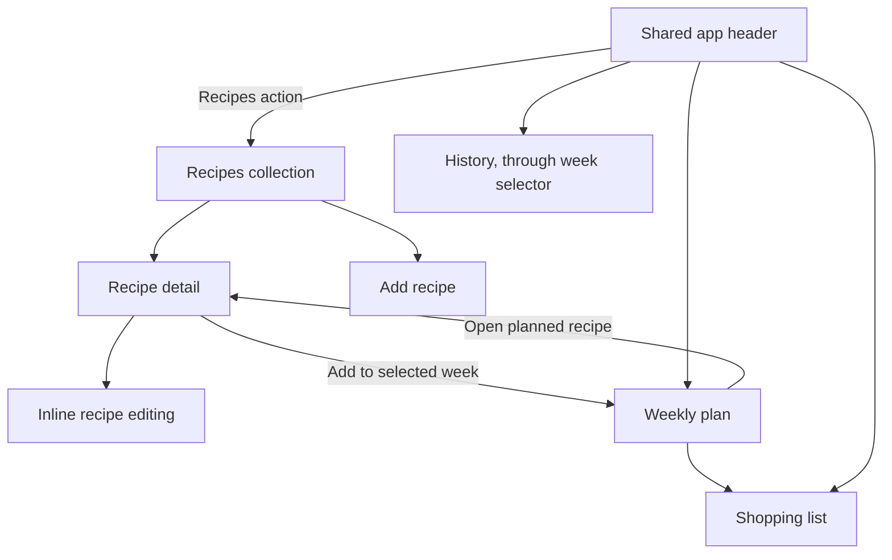

# Cameron Family Table - Experience Architecture

**Status:** Baseline for preserving the current user experience
**Last updated:** November 15, 2026
**Related requirements:** [`PRODUCT_REQUIREMENTS.md`](../PRODUCT_REQUIREMENTS.md)

## Purpose

This document records where existing features live, how users move between
them, and which interaction and layout decisions must remain stable. Read it
with `PRODUCT_REQUIREMENTS.md` before changing the interface.

The requirements document defines product behavior. This document defines the
established experience and its placement. A focused feature request does not
authorize a redesign of adjacent areas. When the product owner explicitly
approves a structural change, update both documents in the same change.

## Information architecture

### Global navigation

- The Recipes collection is its own full-page view. The shared photo/tagline
  header is not shown in this view.
- In the shared header, the circular **Recipes** action returns to the
  collection and keeps a prominent book icon above its label. The app
  background is white, and the week selector is lime with no border. The week
  selector and **Plan**/**Shop** navigation use fully rounded pill shapes.
  Keep the controls content-sized, with the selected pill filling the full
  navigation height. The selected pill glides in both directions and respects
  reduced-motion preferences.
- The week selector chooses **This week**, **Next week**, or **History**.
  History is reached through this selector, not by adding another primary
  navigation tab.
- The Plan tab shows a selected-meal count when the current plan is not empty.
- A fixed refresh action remains at the bottom-right of the main app views.
- A selected recipe and supported view state can be represented in the URL.
  Preserve existing deep-link and browser-navigation behavior.

## Screen and control placement

### Recipes collection

- The collection toolbar places **Back** at the leading edge and the
  **Add recipe** and **Search** actions together at the trailing edge.
- Keep Back at the same top-left anchor in the collection and recipe detail
  views. Opening a recipe must not create a vertical or horizontal jump.
- Search and tag filtering narrow the existing collection; they do not replace
  or hide its primary toolbar.
- Recipe cards show the meal image, title, tag, and available source link.
  Collection and planned-meal cards use varied pastel lime, peach, and blue
  surfaces without an outer border. Their actions and selectors are borderless,
  dropdown surfaces and highlighted options match the card palette, and tags
  use a darker shade of the card surface. All recipe tags share an all-caps,
  regular-weight style with tight letter spacing and responsive 10px mobile
  and 11px desktop text. The `Mark as done` checkbox uses the card tint
  without a border, and its hover uses a light, darker-than-card shade. The
  card's meal title is serif; supporting content and actions are sans-serif.
- A recipe's detail view keeps a neutral background and reuses its
  collection/plan card's control palette for servings. Use a consistent
  light-green hover surface for recipe controls and direction steps. The
  Ingredients/Directions pivot uses the active recipe's lighter control color
  for its track and darker theme color for the selected pill. Ingredient and
  direction checkboxes use the lighter tint when unchecked and darker theme
  color when checked.
- Selecting a recipe opens its detail view. Planned recipe cards use the same
  recipe identity and also open that detail view.

### Recipe detail

The content order is deliberate:

1. A toolbar above the recipe content, aligned to the collection toolbar:
   **Back** on the left; **Add to week**,
   **Edit**, and **Delete** grouped on the right, in that order.
2. The recipe's primary image.
3. Recipe tag and source link.
4. The serif meal title, with the **Cooking for** servings control alongside
   it on wider screens and below it on narrow screens.
5. A divider, then the **Ingredients** / **Directions** tab pivot.
6. The selected tab's content.

Switching tabs slides the selected content horizontally. Disable this
transition when reduced motion is requested.

The toolbar is the stable home for recipe actions. Do not move Edit to the
title, image, page footer, or a separate menu. On mobile, controls may use
compact icon treatments, but their meaning, order, and toolbar location remain
the same.

When the recipe is already planned, the **Add to week** action shows the
week's start date in its confirmation label, such as **Added to Nov 15th
week**.

#### Recipe editing

- Activating **Edit** makes recipe details, ingredients, and directions
  editable in place; it does not open a separate editor page or modal.
- Keep the toolbar action group in place. Replace Edit with exactly one global
  **Save** and **Cancel** pair in that same area. Keep **Back** and
  **Add to week** in their existing positions; keep **Delete** in the toolbar.
- Details, ingredients, and directions remain in their corresponding sections.
  Do not combine them into one editor section or move them to another screen.
- Directions are a list of independent step cards. Each step's text and
  optional image URL belong together. Adding or removing a step must not
  separate its image from its text.
- Save failures remain visible in the recipe view. Cancel discards the
  unsaved draft and returns the recipe to read mode.

#### Cooking view

- Ingredients and Directions remain two tabs, not separate top-level routes or
  navigation destinations.
- The Ingredients/Directions pivot and collapsible ingredient section headers
  use fully rounded pill shapes.
- The Ingredients/Directions selected pill glides in both directions and
  respects reduced-motion preferences; the content panels slide horizontally.
- The **Cooking for** servings control uses the same fully rounded treatment.
- The empty `Used` ingredients message remains light and uses fully rounded
  corners.
- The Ingredients tab has no redundant section title or outer collapse
  control. Its `To use` and `Used` subsections are large text-only headings
  without a colored background, aligned with the ingredient rows and retaining
  left padding in their hover background. They remain individually collapsible
  and move ingredients when checked or unchecked.
- Directions remain ordered, checkable steps with any associated step image.
  Completion feedback stays with the directions experience.
- Preserve the servings control's position below the title on mobile; it must
  not overlap or push recipe actions into a different region.

### Add recipe

- Adding a recipe is a dedicated full-page flow, not a modal.
- It starts with a recipe URL import option and a manual-entry alternative.
- Import review presents the extracted recipe as editable fields before save.
  Manual entry uses the same recipe fields.
- The Save action remains after the editable content. Errors are shown with the
  form, and successful saves add the recipe to the selected week.
- Direction text and its optional image URL remain paired by step during
  import, editing, and saving.

### Weekly plan

- The shared header remains above the planning content, with the week selector
  and Plan/Shop navigation in its lower control row.
- Planned meals are grouped under **To make** and **Done**. Completion moves a
  meal between these groups without removing it from the week's plan.
- Each meal card keeps its day and cook selectors above a green **Mark as
  done** pill action at the bottom. Keep the day and cook placeholders the
  same color and the checkbox aligned with the card content.
- Each meal card retains its servings and completion behavior.
- **Add another recipe** opens recipe picking within the plan flow. Choosing
  a recipe should not change the location of the week selector or primary
  navigation.
- The empty plan invites the user to choose recipes without adding a new
  navigation path.

### Shopping list

- The shared header and selected planning week stay visible above the list.
- The shopping view has exactly two source tabs: **From meals** and
  **Global**.
- **From meals** displays generated ingredients grouped by grocery category.
  Category cards keep rounded light-gray headers, shared-size checkboxes, and
  existing collapse controls. The **From meals** and **Global** source tabs use
  a black selected pill, stretch across their available width, and use a
  sliding active pill that respects
  reduced-motion preferences. On wider screens, columns are balanced and
  aligned from the top.
- **Global** starts with an **Add a task** action styled like Plan's **Add
  another recipe** control. Activating it reveals a task field with embedded
  checkmark and cancel controls; cancel is to the checkmark's right and both
  icons use the same color. Enter adds the item, while Escape or Cancel
  dismisses the field. Its collapsible **To get** and **Completed**
  groups match the **From meals** category cards' headers and item-row styling
  while retaining counts, checkboxes, and remove actions.
- Keep the empty shopping state's action connected to adding meals.

### History

- History is selected from the week selector in the shared header.
- Each saved week card keeps its week range and save date at the top, followed
  by its meal cards and available date/cook details.
- History is read-only with respect to the current recipe collection; deleting
  a current recipe does not rewrite archived meals.

## Shared visual language

- Use the bright, fresh palette: cool blue-gray page surfaces, white cards,
  bright lime section accents, ink-dark text/actions, and soft peach for
  destructive/error emphasis. Do not revert to the former cream palette unless
  requested.
- Keep the existing rounded card and lime section-header treatment.
- Use pill shapes for action and toolbar buttons; icon-only controls remain
  circular. Use rounded form controls with soft blue-gray 1px borders, no drop
  shadows, and a lime focus ring. Keep tertiary text actions quiet and preserve
  clear error, disabled, checked, and reduced-motion states.
- Use a simple chef-hat favicon on a rounded lime tile, with a white hat and
  ink outline.
- Use serif only for meal/recipe titles and the rotating family tagline. All
  navigation, labels, descriptions, section headings, forms, and other
  interface copy use sans-serif.
- Keep photographs attached to the recipe or direction step they describe;
  do not substitute unrelated imagery.
- Keep mobile text, checkboxes, and primary controls comfortable to read and
  tap. Responsive changes may compact controls but must not change their
  hierarchy or move them to unrelated areas.

## Persistence and state boundaries

- Shared recipes, weekly plans, generated and global shopping lists, and meal
  history are persisted through the existing Supabase-backed APIs.
- Browser-local state is a cache or device-specific state, not the authoritative
  copy of shared data.
- The local `?mockRecipes=1` preview is temporary and explicitly indicates
  that edits are not saved. Do not let mock preview behavior leak into normal
  production flows.
- Preserve refresh, synchronization, selected-week, and supported URL state
  when changing view components.

## Change-safety contract

For every future UI change:

1. Identify the existing screen and control that owns the requested feature.
   Change that area only; reuse its established interaction pattern.
2. Preserve navigation labels and hierarchy, screen order, toolbar locations,
   action order, and existing feature availability unless the user explicitly
   requests a change to them.
   In particular, keep the recipe collection/detail Back button anchored at
   the same top-left position.
3. Do not move, reorder, hide, remove, or duplicate controls as an incidental
   cleanup, visual refresh, responsive tweak, or implementation convenience.
4. Keep desktop and mobile layouts recognizable as the same information
   architecture. Responsive adaptations may change size or wrapping, not
   feature ownership or action placement.
5. If the requested behavior cannot be implemented without a structural
   change, explain the conflict and ask the product owner before making that
   change.
6. If an approved change alters an invariant in this document, update this
   architecture and `PRODUCT_REQUIREMENTS.md` together, and verify both the
   changed flow and adjacent flows that must remain stable.

## Authoritative implementation

The current implementation is primarily in `app/page.tsx`, with global
typography and styling in `app/globals.css`, document metadata in
`app/layout.tsx`, and persistence in `app/api/` and `app/lib/`. This document
records intended experience behavior; implementation details may change only
when the documented user experience is preserved or explicitly approved for
change.
